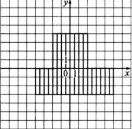
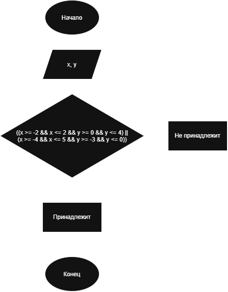

# LAB6DZ
# Домашнее задание (Условие)

Составить программу, которая проверяет, принадлежит ли заданная пользователем точка с координатами (x, y) закрашенной области, показанной на рисунке.

Программа должна вывести сообщение о том, принадлежит точка заданной области или нет.

### Заданная область

Область состоит из двух прямоугольников.



Первый прямоугольник задаётся условиями:

-2 <= x <= 2

0 <= y <= 4

Второй прямоугольник задаётся условиями:

-4 <= x <= 5

-3 <= y <= 0

Точка принадлежит заданной области, если она находится хотя бы в одном из этих прямоугольников.

Условие принадлежности области:


(x >= -2 && x <= 2 && y >= 0 && y <= 4) || (x >= -4 && x <= 5 && y >= -3 && y <= 0)


# 1. Алгоритм и блок-схема

### Алгоритм

1. Объявить переменные x и y.
2. Ввести координаты точки с клавиатуры.
3. Проверить, принадлежит ли точка верхнему прямоугольнику.
4. Проверить, принадлежит ли точка нижнему прямоугольнику.
5. Если выполняется хотя бы одно из условий, вывести сообщение:

`Точка принадлежит области`

6. В противном случае вывести сообщение:

`Точка не принадлежит области`

## Блок-схема



# 2. Реализация программы

Программа реализована на языке C.

Для ввода координат используется функция scanf().

Для проверки принадлежности точки области используются:

"&&" — логическая операция И;

"||" — логическая операция ИЛИ;

">=" и "<=" — операторы сравнения;

if и else — условный оператор.

# 3. Результаты работы программы

Пример 1:
```
Введите x и y: 1 3
Точка принадлежит области
```

Пример 2:
```
Введите x и y: 4 2
Точка не принадлежит области
```

# 4. Информация о разработчике

ФИО: Гордиенко Владимир Денисович

Группа: бОТИ-261
